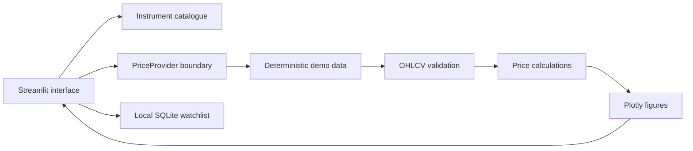

# First-milestone architecture

## Responsibilities

- `app.py`: coordinates native Streamlit widgets, selection, notices and layout. No handwritten HTML/CSS/JavaScript.
- `catalog.py`: exchange-aware company identities and search; independent of Streamlit.
- `providers.py`: history metadata, provider protocol, strict data checks and synthetic fixtures.
- `analytics.py`: range slicing, previous-close changes, visible-range returns and aligned comparisons.
- `watchlist.py`: a local SQLite list, using parameterized statements and unique identities.
- `charts.py`: Plotly price/candlestick, volume and normalized comparison figures.
- `csv_data.py`: bounded canonical CSV parser with explicit unverified source declarations.
- `exports.py`: labelled exports, dataset identity and spreadsheet-safe metadata.
- `performance.py`: descriptive historical price horizons and close-based drawdown.
- `inspect_data.py`: offline command-line structure/coverage inspection.
- `tests/`: numerical examples, invalid-data cases, SQLite restart behavior and Streamlit interaction checks.

## Boundaries

This is a local, single-user demo. Everyone sharing one app process/database would share its watchlist; it is not ready for public multi-user hosting. `EQUITYLENS_DB_PATH` can select an alternative database location; the default is an ignored `data/watchlist.db` under the checkout. Tests use a temporary database, not the user's file.

No market API, LLM key, web retrieval, forecasting pipeline, authentication or deployment is configured. The research/forecast area explains these limitations rather than returning fabricated answers. Add a real-data adapter next, then baseline evaluation, then model comparison and cited retrieval following the weekly roadmap.

A separate FastAPI server is unnecessary for this local milestone. Keeping calculations and providers outside the UI makes later API extraction possible if it becomes useful.

CSV history enters the same validated PriceHistory contract. Accepted uploads stay in session state, scoped to the company; invalid replacements clear old data. Demo peers are disabled in upload mode. Source labels and demo flags persist through charts/exports. Dataset identity is not proof of price accuracy. See CSV_IMPORT_GUIDE.md.
