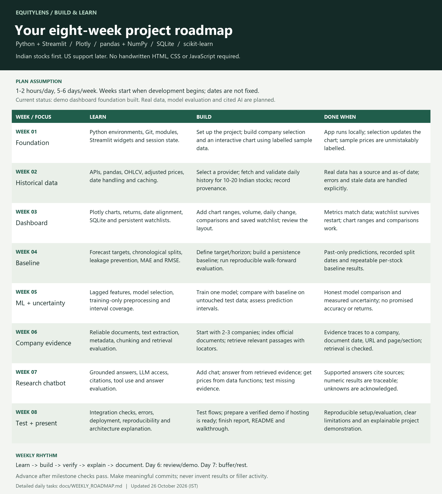

# EquityLens - detailed eight-week roadmap

Last updated: 2026-10-26 (Asia/Calcutta). Planning document, not a record of completed development.

## How we will use this plan

- Workload assumption: 1-2 hours per day, 5-6 days per week; adjust after Week 1.
- Week numbers are relative to the first development week, not fixed calendar deadlines. No start date has been agreed.
- Days 1-5 are focused work, Day 6 is review/demo/catch-up, Day 7 is rest or buffer.
- At the start of each task: understand the idea. Then implement, verify, and explain it in your own words.
- Finish the milestone checks before advancing. Provider access, learning time, and evidence quality may extend the schedule.
- Git commits follow logical useful changes. Ten commits is an aspiration, not a reason to manufacture or split changes.
- Current state: repository cloned, planning saved and demo dashboard foundation implemented with 19 passing local tests. Real data, evaluated models and cited AI remain planned. Review the foundation with the student before moving on; implementation does not mean the learning milestones are complete.

## Milestone overview

| Week | Focus | Deliverable | Dependency |
| --- | --- | --- | --- |
| 1 | Python and Streamlit foundation | Locally running dashboard with labelled sample data | Existing repository |
| 2 | Real historical Indian stock data | Validated, cached history for 10-20 stocks with provenance | Provider selected and access verified |
| 3 | Research dashboard | Interactive chart, metrics, comparisons, persistent watchlist | Clean historical data |
| 4 | Forecast baseline | Reproducible chronological baseline evaluation | Agreed target and usable history |
| 5 | One evaluated ML model | Baseline comparison and assessed prediction intervals | Frozen evaluation protocol |
| 6 | Company evidence retrieval | Relevant document passages with traceable sources | Reliable documents and reuse permissions |
| 7 | Grounded research chatbot | Cited answers and tool-backed price responses | Tested retrieval, selected LLM access |
| 8 | Validation and delivery | Shareable demo, report, architecture, walkthrough | All core milestones verified |

## Week 1 - project foundation

**Learn:** Python functions/modules, virtual environments, dependencies, Git status/diff/commit/push, Streamlit widgets and session state. No handwritten HTML, CSS, or JavaScript required.

| Day | Task | Evidence/output |
| --- | --- | --- |
| 1 | Inspect repository instructions; create an isolated Python environment; select supported Python/Streamlit versions and record dependencies. | Repeatable environment setup instructions. |
| 2 | Create a minimal Streamlit entry point with title and an explicit sample-data notice. | App launches locally without an error. |
| 3 | Build a searchable company selector with exchange/currency metadata; keep the company catalogue separate from UI code. | Selecting an Indian company updates the displayed identity. |
| 4 | Add a data-provider interface and deterministic synthetic daily OHLCV fixture; keep it clearly marked as invented demonstration data. | Same fixture is reproducible; provider can later be replaced. |
| 5 | Display a Plotly price chart; preserve selected stock using session state; handle an empty selection. | Chart updates for a different selected company. |
| 6 | Review the flow from provider to DataFrame to chart; check a fresh launch and basic interactions; update documentation and progress. | Explain the data flow without reading the implementation. |

**Done when:** a fresh environment can launch the app; company selection and chart work; demo data cannot be mistaken for a market quote; no secrets are tracked.

**Learning check:** What does a virtual environment isolate? Why separate data access from the screen? Why is session state needed?

## Week 2 - historical data

**Learn:** HTTP/API requests, pandas DataFrames, date/time handling, OHLCV, adjusted prices, missing values, caching, provider errors and usage rights.

| Day | Task | Evidence/output |
| --- | --- | --- |
| 1 | Compare providers for Indian exchange coverage, historical depth, cost, limits, reliability, and display/redistribution rights. | Written provider decision; unresolved limits documented. |
| 2 | Integrate the chosen provider behind the existing interface; keep any credentials outside Git. | One stock's history retrieved with source and retrieval timestamp. |
| 3 | Validate schema, chronological order, duplicates, numeric values and OHLC consistency; distinguish market closures from missing records. | Data-quality report and meaningful validation tests. |
| 4 | Add caching and refresh controls; handle timeouts, rate limits and provider unavailability. | Cached data has an as-of date; failures show an understandable message. |
| 5 | Extend the catalogue to 10-20 Indian stocks; record currency, exchange, symbol and adjusted-price policy. | Consistent data contract for every supported stock. |
| 6 | Test representative responses and failure cases; document observed coverage and limitations. | Repeatable historical-data workflow. |

**Done when:** real data is traceable to its provider, correctly dated and validated; stale and unavailable data are explicit; synthetic fallback never silently replaces real prices.

**Learning check:** Why can adjusted and unadjusted prices differ? How does a weekend differ from a missing trading session?

## Week 3 - dashboard and watchlist

**Learn:** Plotly interaction, Streamlit layouts and state, return calculations, SQLite persistence, accessible labels, loading/empty/error states.

| Day | Task | Evidence/output |
| --- | --- | --- |
| 1 | Arrange left company search/watchlist, central price chart and a right research area using native Streamlit layout. | Coherent desktop layout; usable narrow-screen fallback. |
| 2 | Add line/candlestick choices, range controls, hover details and volume display. | Chart range and chart type behave consistently. |
| 3 | Compute latest available close, previous close, absolute change and percentage change from the same validated series. | Calculations checked on a small known dataset. |
| 4 | Persist watchlist additions/removals in SQLite; define single-user scope for the first demo. | Watchlist survives app restart without duplicates. |
| 5 | Add historical returns and normalized comparisons with aligned dates and consistent adjustment rules. | Comparisons use an explicit common date range. |
| 6 | Test selection, ranges, restarts, invalid symbols and empty data; review the dashboard as a user. | Working research dashboard walkthrough. |

**Done when:** metrics agree with chart data; watchlist persists; time ranges are clear; INR is shown correctly. Daily data must not be described as real-time/intraday data.

**Learning check:** Why must compared series use compatible dates and price adjustments? What differs between session state and persisted storage?

## Week 4 - forecasting baseline

**Learn:** Prediction target/horizon, chronological splitting, persistence baselines, MAE/RMSE, walk-forward evaluation and data leakage.

| Day | Task | Evidence/output |
| --- | --- | --- |
| 1 | Define target, forecast horizon, evaluation stocks and intended interpretation before training. | Written experiment specification; no accuracy promises. |
| 2 | Establish chronological train/validation/test boundaries and a final untouched test period. | Split dates and data version recorded. |
| 3 | Implement a last-observed-value persistence baseline for the chosen target. | Reproducible baseline predictions with timestamps. |
| 4 | Calculate MAE and RMSE; summarize per stock and per split rather than hiding weak results in one average. | Saved metric and prediction tables. |
| 5 | Add walk-forward evaluation and checks that features and targets never cross the prediction cutoff. | Leakage checks and a reproducible evaluation command. |
| 6 | Show baseline results in the app; explain why a simple baseline can be difficult to beat. | Baseline report with assumptions and limits. |

**Done when:** evaluation can be rerun; each prediction uses only available past data; baseline errors and split dates are recorded.

**Learning check:** Why is a random split usually misleading for time-series forecasting? How would future data enter a rolling feature accidentally?

## Week 5 - one ML model and uncertainty

**Learn:** Lagged/rolling features, training-only preprocessing, one suitable scikit-learn estimator, validation-based selection, residuals and prediction-interval coverage.

| Day | Task | Evidence/output |
| --- | --- | --- |
| 1 | Design past-only lagged and rolling features; document when each feature becomes available. | Feature definitions and alignment checks. |
| 2 | Train one justified model; fit any preprocessing only on training data. | Saved configuration, data version and reproducible pipeline. |
| 3 | Tune a small justified parameter set using chronological validation, without consulting the final test set. | Model-selection record. |
| 4 | Freeze choices, evaluate the untouched test period, and compare the same samples/horizon against baseline. | Honest per-stock baseline-versus-model table. |
| 5 | Build a suitable past-data calibration method for prediction intervals; measure coverage and average width on later data. | Interval evaluation and stated assumptions; no unsupported confidence claims. |
| 6 | Display forecasts, intervals, evaluation window, model version and weaknesses in the dashboard. | Forecast panel with clear provenance. |

**Done when:** results are reproducible; model and baseline share an evaluation protocol; interval quality is measured; a losing model is reported honestly. Market shifts can invalidate historical interval coverage.

**Learning check:** What does lower MAE mean? Why is historical coverage not a guarantee about a future trading day?

## Week 6 - company documents and retrieval

**Learn:** Reliable source selection, PDF/text extraction, document metadata, chunking, lexical/vector retrieval and retrieval evaluation.

| Day | Task | Evidence/output |
| --- | --- | --- |
| 1 | Start with 2-3 companies; select official filings, annual reports and investor documents; record dates and usage restrictions. | Source register with URLs, companies, periods and retrieval dates. |
| 2 | Extract text while preserving page or section references and document identity. | Inspectable text samples linked to originals. |
| 3 | Create document chunks with metadata; exclude empty, garbled and duplicated content. | Reproducible ingestion workflow. |
| 4 | Implement retrieval; choose lexical or embedding-based retrieval based on measured results and available resources. | Queries return ranked passages, not generated answers. |
| 5 | Prepare questions on history, business, financial results and risks; inspect whether relevant evidence appears in results. | Small documented retrieval evaluation set. |
| 6 | Correct extraction/retrieval failures and expand coverage only when the workflow works. | Retrieval demo and coverage limitations. |

**Done when:** every retrieved passage has company, document date, URL and locator; test questions find relevant evidence; unsupported companies are explicit.

**Learning check:** How is retrieval different from generation? Why should an old annual report not be described as today's outlook?

## Week 7 - cited research chatbot

**Learn:** LLM API use, secret handling, grounded prompts, source verification, prompt-injection boundaries, chat state and answer evaluation.

| Day | Task | Evidence/output |
| --- | --- | --- |
| 1 | Select an available LLM access method and cost boundary; keep keys in environment/secrets and out of client output/Git. | Configurable model access; clear missing-key state. |
| 2 | Generate answers from retrieved passages; attach resolvable citations to factual claims. | Cited answers for covered questions. |
| 3 | Route price/date/volume requests to data functions; prevent the LLM from inventing prices or forecasting results. | Numeric answers trace to returned data and timestamps. |
| 4 | Add chat history, company context and visible evidence; define behavior when the company changes. | Conversation stays tied to the intended company. |
| 5 | Evaluate factual support, citation correctness, stale information and unavailable evidence; include malicious instructions embedded in documents. | Answer-quality and boundary test results. |
| 6 | Integrate the chatbot into the dashboard and review sample conversations. | End-to-end research workflow. |

**Done when:** claims are supported; citations open the right source; missing evidence is acknowledged; documents cannot issue tool instructions; model scores are never fabricated.

**Learning check:** What should the assistant say when no evidence supports a claim? Why are retrieved documents data rather than instructions?

## Week 8 - verification, deployment and presentation

**Learn:** Integration testing, configuration, deployment, logs, reproducibility, architecture explanation and technical writing.

| Day | Task | Evidence/output |
| --- | --- | --- |
| 1 | Test core flows and failures: stock selection, provider errors, watchlist persistence, evaluation output and cited questions. | Recorded checks and fixed priority defects. |
| 2 | Profile slow paths; improve caching and resource use; check empty states and small screens. | Usability/performance notes with observations. |
| 3 | Select a Python-compatible host; verify data/model access rules, persistent storage and secret support. | Deployment decision; obtain any required access or publishing approval. |
| 4 | Deploy once ready; test the actual hosted app, configuration, persistence and error behavior. | Verified demo link, or honest documented hosting blocker. |
| 5 | Complete README, architecture diagram, setup guide, model results, limitations and a demonstration script. | Reproducible documentation and presentation material. |
| 6 | Rehearse a short walkthrough and interview questions; prepare resume statements based only on verified achievements. | Explainable final project and realistic next-release backlog. |

**Done when:** another person can follow setup instructions; evaluation is reproducible; hosted behavior is verified if published; known limitations are visible.

**Learning check:** Can you explain the full request/data path? Can you defend the baseline, split, citations and data-provider choice?

## Weekly review checklist

- What works now, and what evidence proves it?
- What did I understand well enough to explain myself?
- Which checks passed or failed?
- What source, date, experiment and configuration produced these results?
- What is blocked, and what is next?
- Update DAILY_PROGRESS.md with actual work; leave future milestones marked planned.

## Choices still pending

Initial exchange (NSE is proposed, not confirmed), exact stock list, licensed data provider, LLM access/budget, forecast target/horizon, model, interval method and hosting provider. US stocks are future scope. Do not promise true live data, predictive accuracy or unlimited free API access.
